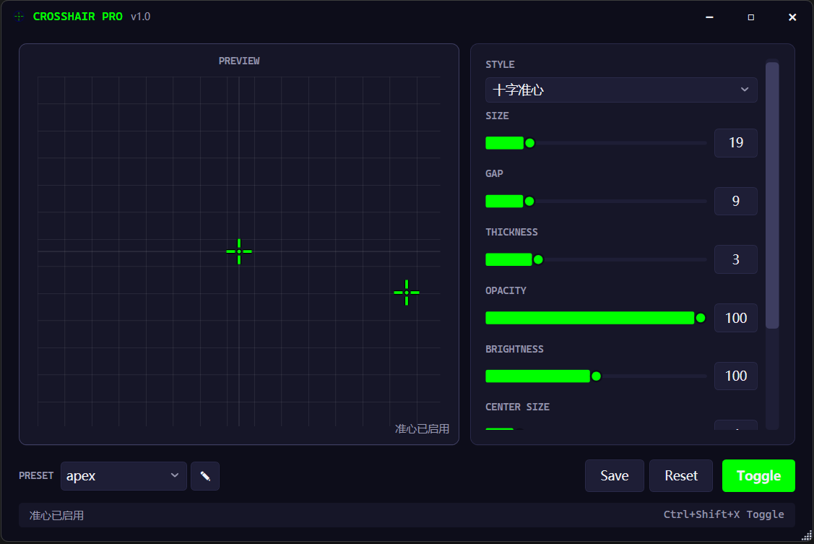

<div align="center">

# CrosshairPro

A customizable **crosshair overlay & game-config toolkit** for FPS gamers on Windows.

[](./LICENSE)
[](https://dotnet.microsoft.com/)
[](https://www.microsoft.com/windows)

<!-- Uncomment after the first GitHub release is published:
[](https://github.com/cilangzzz/Crosshair/releases)
[](https://github.com/cilangzzz/Crosshair/releases)
-->

English | [简体中文](./README.zh-CN.md)



</div>

## 📑 Table of Contents

- [✨ Features](#-features)
- [📦 Download & Install](#-download--install)
- [🚀 Quick Start](#-quick-start)
- [🎮 Game Config Center](#-game-config-center)
- [🛡 Anti-cheat & Safety](#-anti-cheat--safety)
- [🗂 Configuration Files](#-configuration-files)
- [❓ FAQ](#-faq)
- [🗺 Roadmap](#-roadmap)
- [🛠 Development](#-development)
- [🤝 Contributing](#-contributing)
- [📄 License](#-license)

## ✨ Features

**Crosshair overlay**

- 🎯 Six styles: **Cross · Dot · Circle · T-shape · X-shape · Custom image** (PNG / JPG / BMP)
- 🎨 Fine control: size, gap, thickness, color (8 presets + custom picker), opacity, brightness, rotation, center dot
- ✨ Effects: **outline** with adjustable thickness, toggleable **drop shadow**
- 🪟 Click-through topmost overlay — never intercepts your mouse, hidden from the taskbar and Alt-Tab

**Workflow**

- 💾 **Presets**: save / load / delete, JSON import & export, last preset restored on startup
- ⌨️ Global hotkey <kbd>Ctrl</kbd>+<kbd>Shift</kbd>+<kbd>X</kbd> toggles the overlay anywhere, any game
- 🌐 Built-in **Simplified Chinese & English** UI, switchable at any time
- 🔔 System tray: closing the window hides to tray, real exit from the tray menu; single-instance guard

**Game config center**

- 🅰 **Apex Legends**: launch-options builder, sensitivity & per-scope zoom, video quality tuning, one-click presets (competitive / high-quality / default), backup & restore
- 🔫 **Counter-Strike 2**: video & game settings, launch options with a live character counter (Steam's ~1000-char limit), one-click export of a `.cfg` containing only VAC-whitelisted fields
- 🖥 **PC optimization guide**: ~30 curated Windows settings shortcuts (read-only — it changes nothing by itself)

**Trust**

- 🔒 Local-only: plain JSON under `%APPDATA%\CrosshairPro` — no account, no telemetry, works fully offline

## 📦 Download & Install

### Requirements

- Windows 10 or 11 (x64)

### 🟢 Download a build

No binaries are published yet — the first build will land on the [Releases](https://github.com/cilangzzz/Crosshair/releases) page. Until then, [build from source](#-build-from-source) below.

> [!NOTE]
> Builds are not code-signed, so Windows SmartScreen may show a warning. Choose **More info → Run anyway**.

### 🟠 Build from source

The app targets .NET 8 — requires the [.NET 8 SDK](https://dotnet.microsoft.com/download/dotnet/8.0). Building the `CrosshairPro.slnx` solution additionally needs **.NET SDK 9.0.200+** (earlier CLIs cannot parse `.slnx`); with only the .NET 8 SDK, build the app project directly:

```bash
git clone https://github.com/cilangzzz/Crosshair.git
cd Crosshair
dotnet build src/CrosshairPro.App          # works with the .NET 8 SDK
dotnet build CrosshairPro.slnx             # requires .NET SDK 9.0.200+
dotnet run --project src/CrosshairPro.App
```

To produce a self-contained build that doesn't need the .NET runtime installed:

```bash
dotnet publish src/CrosshairPro.App -c Release -r win-x64 --self-contained
# → src/CrosshairPro.App/bin/Release/net8.0-windows/win-x64/publish/CrosshairPro.exe
```

## 🚀 Quick Start

1. Launch CrosshairPro — closing the window hides it to the tray instead of exiting.
2. On the **Crosshair** tab, pick a style and tune size / color / gap to taste.
3. Switch to your game running in **windowed or borderless** mode.
4. Press <kbd>Ctrl</kbd>+<kbd>Shift</kbd>+<kbd>X</kbd> anywhere to show or hide the crosshair.
5. Right-click the tray icon to show the window, toggle the crosshair, or exit.

> [!TIP]
> The hotkey is global — it works while any application has focus, including games.

## 🎮 Game Config Center

The **Games** tab bundles per-game configuration channels behind a single selector.

### 🅰 Apex Legends

- **Launch options**: toggle-and-slider builder for ~20 parameters (high priority, `-novid`, `-nojoy`, refresh rate, FPS cap, FOV scale, interp values, …) with a live preview, `launch_options.txt` generation you can paste into Steam, and copy-to-clipboard
- **settings.cfg**: mouse sensitivity, mouse acceleration, and per-scope sensitivity scalars (1×–6×, plus one shared slider for 8×/10×)
- **videoconfig.txt**: gamma, texture / shadow / particle / volumetric quality, SSAO, anti-aliasing, vsync, dynamic resolution
- **One-click presets**: 竞技优化 (competitive) · 高画质 (high quality) · 默认 (default)
- **Safety net**: per-file backup / restore / export with backup history; Replace and Restore always back the game file up first. Note: the in-app **Save** button writes `videoconfig.txt` / `settings.cfg` **without** creating a backup — run **Backup** first if you want a safety copy.

### 🔫 Counter-Strike 2

- **Video settings** (stored in-app; included as comments in the exported `.cfg`): fullscreen, resolution, aspect ratio, refresh rate
- **Game settings**: `fps_max` (0 = unlimited), `cl_showfps`
- **Launch options**: full Steam command line with a live 1000-character limit counter
- **Config export**: one-click generation of a `.cfg` file containing **whitelisted, non-VAC-monitored fields only**, written UTF-8 without BOM
- The page shows whether CS2 is currently running. Settings are saved to the app's own config for now — direct write-back to game files is on the roadmap.

### 🖥 PC optimization

Seven categories (System · Power · Display · Network · Storage · Drivers · Input/Audio) with ~30 items, each explaining the tweak, the expected gain, and a button that opens the matching Windows settings page. The guide **modifies nothing on its own** — you stay in control — and includes a "myths" section debunking registry cleaners, service disablers, RAM boosters and friends.

## 🛡 Anti-cheat & Safety

- **External overlay by design.** The crosshair is drawn in a separate transparent topmost window (`WS_EX_TRANSPARENT | WS_EX_TOOLWINDOW`). No DLL injection, no game memory access, no game files touched by the overlay itself.
- **Fullscreen caveat.** In *exclusive* fullscreen the game may draw over the overlay. Use **windowed or borderless** mode — this is how every external overlay works.
- **Anti-cheat honesty.** External overlays are broadly tolerated, but some anti-cheats (BattlEye, EAC, Vanguard) restrict *any* overlay per game — always check your game's rules before using one.
- **CS2 config policy.** The `.cfg` export writes only whitelisted, non-VAC-monitored fields and never touches `sv_cheats`, `cl_crosshair*` or weapon parameters. See the [CS2 pitfalls doc](docs/GameConfig/CS2/pitfalls.md) for the full policy.
- **You are responsible** for how you use the tool. Use at your own risk.

## 🗂 Configuration Files

The app keeps all of its own data in one folder:

```
%APPDATA%\CrosshairPro\
├── config.json         # current crosshair configuration
├── appstate.json       # last preset ID & UI language
├── presets/            # saved presets ({id}.json)
├── gameconfigs/        # per-game settings (builtin-apex.json, builtin-cs2.json, …)
├── launch_options.txt  # generated Apex launch options
└── apex-backups/       # Apex videoconfig / settings backups
```

> Exception: the Apex **Replace / Restore** flows read and write the real game files under `%USERPROFILE%\Saved Games\Respawn\Apex\local\`, and the CS2 `.cfg` export goes wherever you choose to save it.

Uninstalling is the reverse: exit from the tray, delete the app folder, delete this folder. If you used the Apex config tools, restore your game files from `apex-backups/` **before** deleting it.

## ❓ FAQ

**Will I get banned for using this?**
The overlay itself is a passive external window — no injection, no memory access. Most anti-cheats tolerate that; a few restrict any overlay per game. The CS2 `.cfg` export stays inside the VAC whitelist. Still, check your game's rules — final responsibility is yours.

**The crosshair doesn't show in my game.**
Your game is running in exclusive fullscreen and draws over the overlay. Switch the game to windowed or borderless mode.

**Does it support multi-monitor?**
The overlay currently covers the primary monitor. Multi-monitor support is on the roadmap.

**How do I fully remove it?**
Exit from the tray icon, delete the application folder, then delete `%APPDATA%\CrosshairPro`. If you used the Apex config tools, restore your game files from the `apex-backups/` folder first.

## 🗺 Roadmap

- [x] Crosshair overlay: 6 styles, outline & shadow, rotation / brightness / center dot
- [x] Preset system: save, import / export, startup restore
- [x] System tray & single instance
- [x] zh-CN / en-US localization
- [x] Apex Legends config center (launch options · settings · videoconfig · backups)
- [x] CS2 config center (in-app settings · whitelisted `.cfg` export)
- [x] PC optimization guide
- [ ] Game auto-detection
- [ ] Multi-monitor support
- [ ] Glow effect rendering
- [ ] Per-preset hotkeys & game association
- [ ] CS2 direct config write-back (currently export-only)

## 🛠 Development

| Component | Technology |
|------|------|
| Framework | WPF + .NET 8 (C# 12) |
| Architecture | MVVM, 5-layer solution |
| MVVM toolkit | CommunityToolkit.Mvvm 8.3.2 |
| Logging | Serilog |
| Tray icon | Hardcodet.NotifyIcon.Wpf |

```
src/
├── CrosshairPro.Core/            # models, interfaces, enums (no dependencies)
├── CrosshairPro.Infrastructure/  # Win32 P/Invoke, global hotkeys
├── CrosshairPro.Services/        # JSON persistence, crosshair rendering
├── CrosshairPro.Application/     # business services, DI registration
└── CrosshairPro.App/             # WPF UI: views, viewmodels, localization
```

Module-level docs (architecture, data model, per-game config protocols, pitfalls, changelogs) live in the [docs index](docs/INDEX.md).

## 🤝 Contributing

Issues and pull requests are welcome. For bug reports, please include your Windows version and the steps to reproduce. Build instructions are in [Development](#-development) above.

## 📄 License

[MIT](./LICENSE) © Cilang. This software is provided **as-is** — use at your own risk and in accordance with the rules of the games you play.
