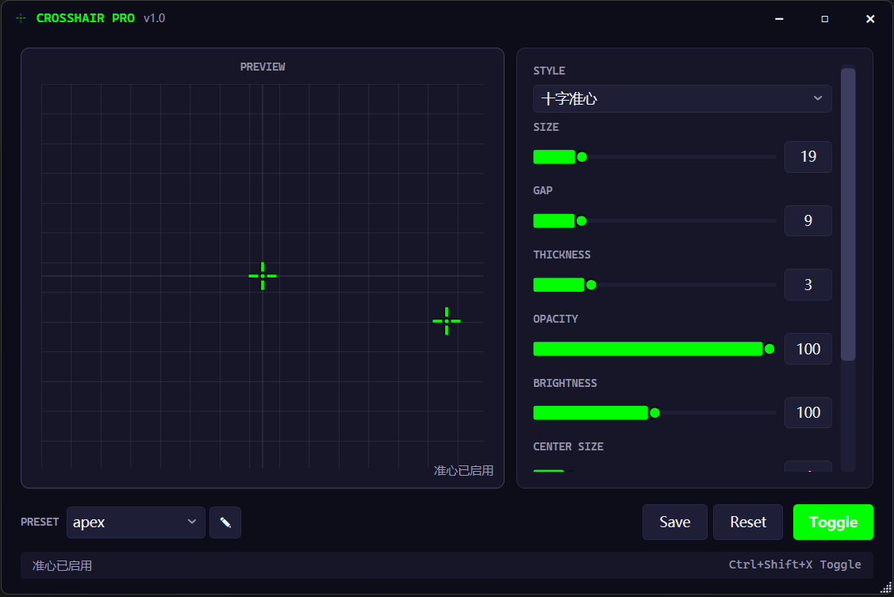

<div align="center">

# CrosshairPro

面向 FPS 玩家的 Windows **准心覆盖与游戏配置工具**。

[](./LICENSE)
[](https://dotnet.microsoft.com/)
[](https://www.microsoft.com/windows)

<!-- 首个 GitHub Release 发布后取消注释：
[](https://github.com/cilangzzz/Crosshair/releases)
[](https://github.com/cilangzzz/Crosshair/releases)
-->

[English](./README.md) | 简体中文



</div>

## 📑 目录

- [✨ 功能特性](#-功能特性)
- [📦 下载与安装](#-下载与安装)
- [🚀 快速上手](#-快速上手)
- [🎮 游戏配置中心](#-游戏配置中心)
- [🛡 反作弊与安全性](#-反作弊与安全性)
- [🗂 配置文件说明](#-配置文件说明)
- [❓ 常见问题](#-常见问题)
- [🗺 路线图](#-路线图)
- [🛠 开发](#-开发)
- [🤝 参与贡献](#-参与贡献)
- [📄 许可证](#-许可证)

## ✨ 功能特性

**准心覆盖**

- 🎯 六种样式：**十字 · 点 · 圆 · T形 · X形 · 自定义图片**（支持 PNG / JPG / BMP）
- 🎨 精细调节：大小、间隙、厚度、颜色（8 种预设色 + 自定义取色器）、透明度、亮度、旋转、中心点
- ✨ 效果增强：粗细可调的**描边**、可开关的**阴影**
- 🪟 鼠标穿透置顶覆盖 —— 不拦截任何鼠标操作，任务栏与 Alt-Tab 中不可见

**使用体验**

- 💾 **预设管理**：保存 / 加载 / 删除，JSON 导入导出，启动时自动恢复上次预设
- ⌨️ 全局热键 <kbd>Ctrl</kbd>+<kbd>Shift</kbd>+<kbd>X</kbd>，任何界面、任何游戏中随时显示 / 隐藏准心
- 🌐 内置**简体中文 / English** 双语界面，随时切换
- 🔔 系统托盘：关闭窗口即最小化到托盘，托盘菜单真正退出；单实例运行保护

**游戏配置中心**

- 🅰 **Apex 英雄**：启动项可视化生成器、鼠标灵敏度与倍镜独立灵敏度、画质调节、一键预设（竞技优化 / 高画质 / 默认）、备份与恢复
- 🔫 **反恐精英 2（CS2）**：视频与游戏设置、启动项编辑（实时字符计数，上限 1000，对应 Steam 启动项长度限制）、一键导出仅含 VAC 白名单字段的 `.cfg`
- 🖥 **PC 优化指南**：近 30 条精选 Windows 设置直达入口（只读引导 —— 本身不改动任何系统设置）

**可信**

- 🔒 纯本地存储：所有配置以 JSON 保存于 `%APPDATA%\CrosshairPro` —— 无账号、无遥测、完全离线可用

## 📦 下载与安装

### 环境要求

- Windows 10 / 11（x64）

### 🟢 下载安装包

暂未发布任何二进制版本 —— 首个版本将发布在 [Releases](https://github.com/cilangzzz/Crosshair/releases) 页面，在此之前请参考下文[从源码构建](#-从源码构建)。

> [!NOTE]
> 程序暂未做代码签名，Windows SmartScreen 可能弹出警告。选择 **更多信息 → 仍要运行** 即可。

### 🟠 从源码构建

应用目标框架为 .NET 8，需安装 [.NET 8 SDK](https://dotnet.microsoft.com/download/dotnet/8.0)。构建 `CrosshairPro.slnx` 解决方案还需 **.NET SDK 9.0.200+**（更早版本的 CLI 无法解析 `.slnx`）—— 若只装了 .NET 8 SDK，可直接构建应用项目：

```bash
git clone https://github.com/cilangzzz/Crosshair.git
cd Crosshair
dotnet build src/CrosshairPro.App          # .NET 8 SDK 即可
dotnet build CrosshairPro.slnx             # 需要 .NET SDK 9.0.200+
dotnet run --project src/CrosshairPro.App
```

如需生成不依赖 .NET 运行时的自包含版本：

```bash
dotnet publish src/CrosshairPro.App -c Release -r win-x64 --self-contained
# → src/CrosshairPro.App/bin/Release/net8.0-windows/win-x64/publish/CrosshairPro.exe
```

## 🚀 快速上手

1. 启动 CrosshairPro —— 关闭窗口只是隐藏到托盘，不会退出。
2. 在 **准心** 页选择样式，调节大小 / 颜色 / 间隙，实时预览。
3. 将游戏切换到**窗口化或无边框**模式。
4. 任意界面按 <kbd>Ctrl</kbd>+<kbd>Shift</kbd>+<kbd>X</kbd> 显示或隐藏准心。
5. 右键托盘图标可打开主窗口、切换准心或退出程序。

> [!TIP]
> 热键是全局的 —— 任何应用获得焦点时都有效，包括游戏中。

## 🎮 游戏配置中心

**游戏** 页通过选择器切换各游戏的专属配置通道。

### 🅰 Apex 英雄

- **启动项**：约 20 个参数的开关 + 滑杆可视化生成器（高优先级、`-novid`、`-nojoy`、刷新率、FPS 上限、FOV、interp 参数等），实时预览、生成 `launch_options.txt`、一键复制
- **settings.cfg**：鼠标灵敏度、鼠标加速，以及各倍镜独立灵敏度（1×–6×，8×/10× 共用一根滑杆）
- **videoconfig.txt**：伽马、纹理 / 阴影 / 粒子 / 体积光质量、SSAO、抗锯齿、垂直同步、动态分辨率
- **一键预设**：竞技优化 · 高画质 · 默认
- **安全网**：逐文件备份 / 恢复 / 导出与备份历史；替换与恢复操作总会先备份游戏文件。注意：应用内直接**保存**会原样覆写 `videoconfig.txt` / `settings.cfg` 且**不自动备份** —— 需要保险请先执行**备份**。

### 🔫 反恐精英 2（CS2）

- **视频设置**（仅保存于应用内，导出的 `.cfg` 中以注释形式附带）：全屏、分辨率、宽高比、刷新率
- **游戏设置**：`fps_max`（0 = 不限）、`cl_showfps`
- **启动项**：完整 Steam 启动命令行，实时显示 1000 字符上限计数
- **配置导出**：一键生成 `.cfg` 文件，**仅包含白名单内不受 VAC 监控的字段**，UTF-8 无 BOM 编码
- 页面会显示 CS2 当前是否在运行（仅提示）。当前所有设置只保存到应用本地配置，直接写回游戏文件已在路线图中。

### 🖥 PC 优化

七大分类（系统 · 电源 · 显示 · 网络 · 存储 · 驱动与显卡 · 输入与音频）约 30 个条目，每条说明调优内容、预期收益，并附一键打开对应 Windows 设置页的按钮。指南**本身不修改任何系统设置** —— 改与不改由你决定，另附「优化误区」板块，澄清注册表清理、禁用服务、内存加速器等常见陷阱。

## 🛡 反作弊与安全性

- **纯外部覆盖设计。** 准心绘制在独立的透明置顶窗口（`WS_EX_TRANSPARENT | WS_EX_TOOLWINDOW`）中：无 DLL 注入、不读取游戏内存、覆盖层本身不触碰任何游戏文件。
- **全屏注意。** *独占*全屏模式下游戏画面可能覆盖准心，请使用**窗口化或无边框**模式 —— 这是一切外部覆盖工具的通用前提。
- **反作弊如实说明。** 外部覆盖层总体上被普遍容忍，但部分反作弊（BattlEye、EAC、Vanguard）会在个别游戏中限制*任何*覆盖层 —— 使用前请先确认你所玩游戏的规则。
- **CS2 配置策略。** `.cfg` 导出仅写入白名单内不受 VAC 监控的字段，绝不触及 `sv_cheats`、`cl_crosshair*` 或武器参数。完整策略见 [CS2 注意事项文档](docs/GameConfig/CS2/pitfalls.md)。
- **使用本工具产生的后果由你自行承担**，请遵守你所游玩游戏的规则，风险自负。

## 🗂 配置文件说明

应用自身的全部数据都集中在一个目录：

```
%APPDATA%\CrosshairPro\
├── config.json         # 当前准心配置
├── appstate.json       # 上次预设 ID 与界面语言
├── presets/            # 保存的预设（{id}.json）
├── gameconfigs/        # 各游戏配置（builtin-apex.json、builtin-cs2.json 等）
├── launch_options.txt  # 生成的 Apex 启动项
└── apex-backups/       # Apex videoconfig / settings 备份
```

> 例外：Apex 的**替换 / 恢复**流程会直接读写游戏目录下的 `videoconfig.txt` / `settings.cfg`（`%USERPROFILE%\Saved Games\Respawn\Apex\local\`）；CS2 导出的 `.cfg` 保存路径由你选择。

卸载即上述过程的逆操作：从托盘退出、删除程序目录、删除该目录。若使用过 Apex 配置功能，删除前请先从 `apex-backups/` 恢复游戏文件。

## ❓ 常见问题

**使用这个软件会被封号吗？**
覆盖层本身是被动的外部窗口 —— 无注入、不读取内存，大多数反作弊对此容忍，少数反作弊会在个别游戏中限制任何覆盖层。CS2 `.cfg` 导出严格遵守 VAC 白名单。但请务必先确认你所玩游戏的规则，最终责任由使用者承担。

**游戏里看不到准心。**
游戏正运行在独占全屏模式，画面覆盖在准心之上。将游戏切换为窗口化或无边框模式即可。

**支持多显示器吗？**
覆盖层目前仅覆盖主显示器，多显示器支持已在路线图中。

**如何彻底卸载？**
从托盘图标退出，删除程序目录，再删除 `%APPDATA%\CrosshairPro`。若使用过 Apex 配置功能，请先从其中的 `apex-backups/` 恢复游戏文件再删除。

## 🗺 路线图

- [x] 准心覆盖：6 种样式、描边与阴影、旋转 / 亮度 / 中心点
- [x] 预设系统：保存、导入导出、启动恢复
- [x] 系统托盘与单实例
- [x] 简体中文 / English 双语界面
- [x] Apex 英雄配置中心（启动项 · 设置 · 画质 · 备份）
- [x] CS2 配置中心（应用内设置 · 白名单 `.cfg` 导出）
- [x] PC 优化指南
- [ ] 游戏自动检测
- [ ] 多显示器支持
- [ ] 发光效果渲染
- [ ] 预设独立热键与游戏关联
- [ ] CS2 配置直接写回（当前仅支持导出）

## 🛠 开发

| 组件 | 技术 |
|------|------|
| 框架 | WPF + .NET 8（C# 12） |
| 架构 | MVVM，五层解决方案 |
| MVVM 框架 | CommunityToolkit.Mvvm 8.3.2 |
| 日志 | Serilog |
| 托盘图标 | Hardcodet.NotifyIcon.Wpf |

```
src/
├── CrosshairPro.Core/            # 模型、接口、枚举（零依赖）
├── CrosshairPro.Infrastructure/  # Win32 P/Invoke、全局热键
├── CrosshairPro.Services/        # JSON 持久化、准心渲染
├── CrosshairPro.Application/     # 业务服务、依赖注入注册
└── CrosshairPro.App/             # WPF 界面：视图、ViewModel、本地化
```

各模块的详细文档（架构、数据模型、游戏配置协议、注意事项、变更日志）见[文档索引](docs/INDEX.md)。

## 🤝 参与贡献

欢迎提交 Issue 与 Pull Request。提交 Bug 报告时请附上 Windows 版本与复现步骤。构建方法见上文[开发](#-开发)一节。

## 📄 许可证

[MIT](./LICENSE) © Cilang。本软件按「现状」提供 —— 请在遵守所玩游戏规则的前提下自行承担使用风险。
